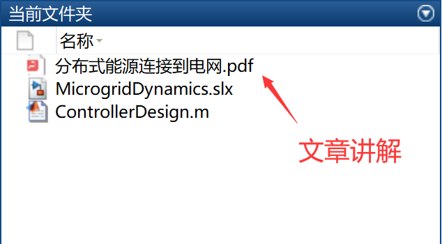

# Distributed Energy Connection to the Grid

Modeling of Microgrid Dynamics - Control and - Simulation Support with the Latest Version of Matlab

Involvement in modeling a microgrid with two grids after the connection of distributed energy sources to the grid, designing its control, and testing the model under island operation mode.

## Images

<!-- PAYMENT_BLOCK -->

## Get this dataset

- Payment link (Stripe): [Buy now](https://buy.stripe.com/3cs8yP7sY87d0vu9AB)
- Payment QR code: 

<!-- /PAYMENT_BLOCK -->
